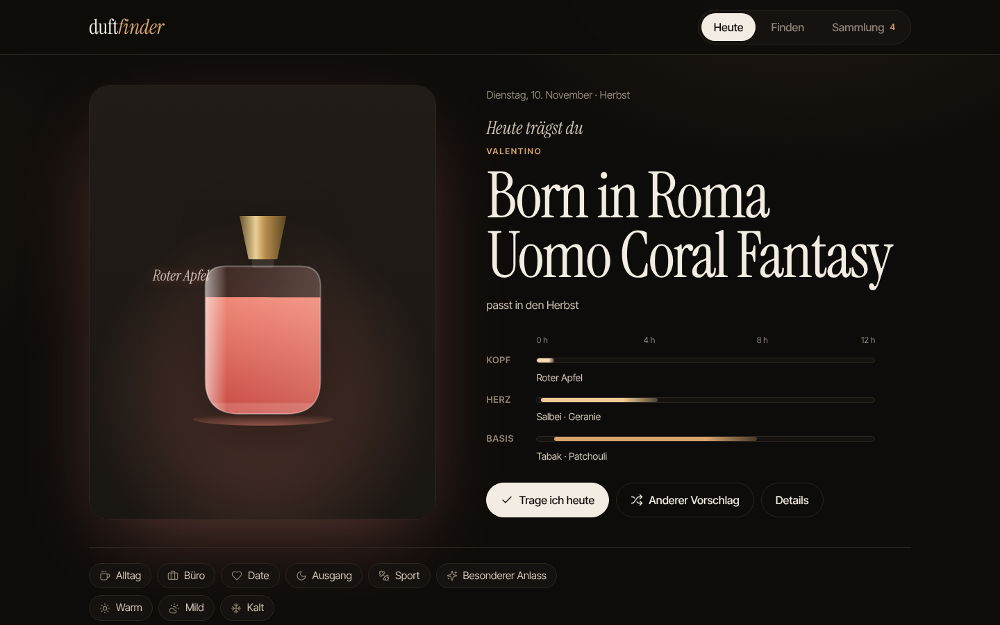

# duftfinder

Ich sammle Parfums und wollte zwei Dinge an einem Ort: neue Düfte finden, die zu einem Anlass und zur Jahreszeit passen, und morgens schnell entscheiden, welchen aus meiner Sammlung ich trage.

**Live:** https://antony-bdc.github.io/duftfinder/



## Was es kann

- **Heute:** schlägt aus der eigenen Sammlung einen Duft vor. Berücksichtigt Jahreszeit, Anlass, Wetter, die eigene Bewertung und was in den letzten Tagen schon getragen wurde. Der Duftverlauf zeigt, wie lange Kopf-, Herz- und Basisnote ungefähr wahrnehmbar sind.
- **Finden:** 49 bekannte Düfte nach Anlass, Jahreszeit, Tageszeit, Duftfamilie und Lieblingsnoten filtern, Noten ausschliessen, oder nach Ähnlichkeit zu einem Duft sortieren, den man schon mag.
- **Sammlung:** Düfte bewerten, eigene Düfte erfassen, Sammlung als JSON exportieren und wieder importieren.
- **Bilder:** Jeder Duft hat einen eigens gezeichneten Flakon in der Farbe seiner Duftfamilie. Für die eigene Sammlung kann man ein Foto der echten Flasche aufnehmen; es wird im Browser verkleinert und bleibt auf dem Gerät.
- **Bewegung mit Bedeutung:** Beim Tagesvorschlag steigen die Duftnoten aus dem Flakon auf, Kopfnoten zuerst und schnell, die Basis zuletzt und langsam, genau wie auf der Haut. Beim Filtern sortieren sich die Karten animiert um (GSAP Flip). Mit «Bewegung reduzieren» im System bleibt alles ruhig.
- Läuft als PWA auch offline und lässt sich auf dem Handy installieren.

## Wie die Ähnlichkeit berechnet wird

Jeder Duft wird zu einer Menge gewichteter Noten: Kopfnoten 0.6, Herznoten 0.8, Basisnoten 1.0, weil die Basis am längsten auf der Haut bleibt. Zwei Düfte vergleiche ich mit einem gewichteten Jaccard-Index über diese Noten (70 %), dazu kommen gleiche Duftfamilie (20 %) und gemeinsame Jahreszeiten (10 %). Die Logik steckt in [`engine.js`](engine.js) als reine Funktionen ohne DOM-Zugriff und ist mit `node --test` abgedeckt.

## Aufbau

| Datei | Inhalt |
|---|---|
| `index.html` | Markup, Styles, Icon-Sprite (Lucide) |
| `app.js` | Oberfläche, Zustand, Speicherung im Browser |
| `engine.js` | Filter, Ranking, Ähnlichkeit, Tagesvorschlag, Import-Prüfung |
| `perfumes.js` | Duftdaten |
| `bottle.js` | Flakon-Illustrationen als SVG |
| `vendor/` | GSAP und Flip, selbst gehostet |
| `sw.js` | Offline-Cache |
| `tests/` | Unit-Tests für Daten und Logik |

Kein Build-Schritt. GSAP, Schriften (Instrument Serif, Inter Tight) und Icons sind selbst gehostet, die App lädt nichts von fremden Servern.

```bash
npm test                       # Tests
python3 -m http.server 8000    # lokal öffnen: http://localhost:8000
```

GitHub Actions testet jeden Push und veröffentlicht `main` auf GitHub Pages.

## Daten

Die Flakons sind eigene Illustrationen und zeigen nicht die echten Produkte. Die Duftnoten stammen aus den Angaben der Hersteller und sind vereinfacht. Jahreszeit, Anlass und Stärke sind meine Einschätzung. Die Sammlung bleibt im `localStorage` des Browsers und verlässt das Gerät nicht.

## Lizenz

Code: MIT. Icons: [Lucide](https://lucide.dev) (ISC). Animation: [GSAP](https://gsap.com) (GSAP Standard License). Schriften: Instrument Serif und Inter Tight (SIL Open Font License).
